# Dynamic Flexibility Management of Battery Energy Storage in Hybrid AC/DC Distribution Networks: A Health-Aware Flexibility Envelope Approach

**Mustafa A. Kamoona, Juan Manuel Mauricio**
Department of Electrical Engineering, Universidad de Sevilla, Seville, Spain

Research code, numerical datasets and figures accompanying the study.

---

## Contents

1. [Overview](#overview)
2. [Problem and motivation](#problem-and-motivation)
3. [The DFM framework](#the-dfm-framework)
4. [Energy management and real-time operation](#energy-management-and-real-time-operation)
5. [Test system](#test-system)
6. [Evaluated strategies](#evaluated-strategies)
7. [Figures of the paper](#figures-of-the-paper)
8. [Supporting figures](#supporting-figures)
9. [Main results](#main-results)
10. [Scope and limitations](#scope-and-limitations)
11. [Repository structure](#repository-structure)
12. [Installation and use](#installation-and-use)
13. [Reproducibility](#reproducibility)
14. [Data availability](#data-availability)
15. [Citation](#citation)
16. [License, acknowledgments and funding](#license-acknowledgments-and-funding)

---

## Overview

Battery energy storage systems (BESSs) are usually represented in energy management by fixed
charge/discharge ratings and a state-of-charge (SOC) window. This study proposes **Dynamic Flexibility
Management (DFM)**: at every 15-min supervisory interval, the BESS flexibility is computed as a
**time-varying charge/discharge envelope** that accounts jointly for the stored energy, the battery
state of health (SOH), a daily degradation allowance, a probabilistic reserve against forecast errors,
and the power that the hybrid AC/DC network can actually deliver. The envelope is imposed as an
operating constraint of a rolling-horizon mixed-integer linear program (MILP), rather than representing
battery degradation only as a cost term.

The framework is evaluated on the hybrid AC/DC adaptation (Topology-3) of the CIGRE European
low-voltage benchmark with DC-side photovoltaic (PV) and wind generation, through comparisons with
conventional and degradation-aware benchmarks, an ablation of its components, a sensitivity analysis of
its design parameters, and 100 Monte Carlo realizations of renewable and demand forecast errors.

**Main findings** (100 Monte Carlo realizations, DFM relative to the degradation-aware benchmark B2):
renewable curtailment -87.9 %, battery health consumption -29.7 %, energy cost
-2.3 %; realizations with a network-constraint violation 70 % → 33 %
(37 % without storage); mean MILP solution time 285 ms.

## Problem and motivation

The conventional representation of a BESS in energy management is the static box

```math
-P_{\mathrm{B}}^{\mathrm{rated}} \le P_{\mathrm{B},k} \le P_{\mathrm{B}}^{\mathrm{rated}},
\qquad SOC_{\min} \le SOC_k \le SOC_{\max},
```

with $`P_{\mathrm{B},k}>0`$ for discharge. It states what the converter can do at one instant, but not

- how much power the battery can **sustain** over a required support period,
- how much it **should** provide given its health and its degradation budget,
- how much must be **withheld** to compensate forecast errors, and
- how much the **network can deliver** without violating voltage, current or converter limits.

In a hybrid AC/DC network, power exchanged at a DC bus is shared by several converters and reaches the
AC feeders through them, so the deliverable power can be far below the nameplate rating. DFM therefore
treats BESS flexibility as an endogenous, time-varying operating region instead of a device rating.

## The DFM framework

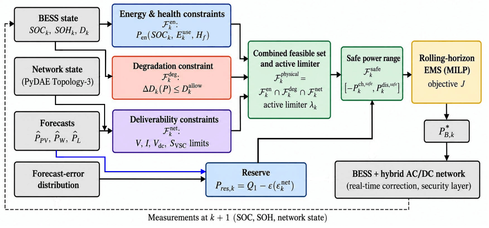

*Information flow of the DFM framework (author-created schematic; figure of the paper).* At each
interval the battery state, the network model and the forecast-error distribution define three physical
limits and a directional uncertainty reserve; their combination is the safe envelope within which the
rolling-horizon EMS selects the BESS operating point.

### Nested flexibility sets

```math
\mathcal{F}^{\mathrm{rated}} \supseteq \mathcal{F}^{\mathrm{physical}}_k \supseteq \mathcal{F}^{\mathrm{safe}}_k,
\qquad
\mathcal{F}^{\mathrm{physical}}_k = \mathcal{F}^{\mathrm{en}}_k \cap \mathcal{F}^{\mathrm{deg}}_k \cap \mathcal{F}^{\mathrm{net}}_k
```

### Energy and health limit

For a support horizon $`H_f`$ and the health-dependent usable energy $`E^{\mathrm{use}}_k = SOH_k\,E_{\mathrm{rated}}`$:

```math
P^{\mathrm{dis}}_{\mathrm{en},k} = \min\left\{P^{\mathrm{rated}}_{\mathrm{dis}},\ \frac{(SOC_k-SOC_{\min})\,E^{\mathrm{use}}_k\,\eta_{\mathrm{dis}}}{H_f}\right\},
\qquad
P^{\mathrm{ch}}_{\mathrm{en},k} = \min\left\{P^{\mathrm{rated}}_{\mathrm{ch}},\ \frac{(SOC_{\max}-SOC_k)\,E^{\mathrm{use}}_k}{\eta_{\mathrm{ch}}\,H_f}\right\}
```

### Degradation limit

Battery aging follows the semi-empirical model of Xu et al. (2018) with its published LMO-cell
parameters. With the cycle-depth and SOC stress functions
$`\Phi(\delta) = (k_{\delta 1}\delta^{k_{\delta 2}} + k_{\delta 3})^{-1}`$ and
$`S_\sigma(\sigma) = e^{k_\sigma(\sigma-\sigma_{\mathrm{ref}})}`$, the accumulated degradation including
the initial SEI-film formation is

```math
D = L(F) = 1-\alpha_{\mathrm{sei}}e^{-\beta_{\mathrm{sei}}F}-(1-\alpha_{\mathrm{sei}})e^{-F},
\qquad SOH = 1-D .
```

For online use the cycle depth is measured from the upper SOC limit, $`\delta_k = SOC_{\max}-SOC_k`$, and a
full cycle of depth $`\delta`$ starting at $`SOC_{\max}`$ has stress
$`G(\delta) = \Phi(\delta)\,S_\sigma(SOC_{\max}-\delta/2)`$. The daily cycle-degradation budget corresponds
to $`N_{\mathrm{ref}}`$ reference cycles of depth $`DoD_{\mathrm{ref}}`$:

```math
D^{\max} = L'(F_k)\,N_{\mathrm{ref}}\,G(DoD_{\mathrm{ref}}),\qquad
D^{\mathrm{allow}}_k = \max\{0,\ D^{\max}-D^{\mathrm{cyc}}_k\},
```

and the degradation-limited powers are

```math
P^{\mathrm{dis}}_{\mathrm{deg},k} = \max\{0\le P\le P^{\mathrm{rated}}_{\mathrm{dis}} : \Delta D_k(P)\le D^{\mathrm{allow}}_k\},\qquad
P^{\mathrm{ch}}_{\mathrm{deg},k} = \max\{0\le P\le P^{\mathrm{rated}}_{\mathrm{ch}} : \Delta D_k(-P)\le D^{\mathrm{allow}}_k\},
```

where $`\Delta D_k(P)`$ is the cycle-induced degradation if $`P`$ were sustained for $`H_f`$ from the current
state (truncated at the SOC limits). It is non-decreasing in $`|P|`$, so both limits are found by
bisection.

**Exact state update and linearized envelope limit.** The aging model is used at two levels:

- *Battery state (exact, nonlinear).* After each interval the linearized degradation is advanced with
  the realized cycle and calendar stress, $`F_{k+1} = F_k + \tfrac{1}{2}\lvert G(\delta_{k+1}) - G(\delta_k)\rvert + \Delta F^{\mathrm{cal}}_k`$,
  and the state of health follows the full capacity-fade function, $`SOH_{k+1} = 1 - L(F_{k+1})`$.
  Reported health consumption is evaluated ex post by rainflow counting of the realized SOC trajectory.
- *Envelope limit (local linearization, cycle stress only).* For the degradation limit, the increment of
  a candidate power is linearized at the current state,
  $`\Delta D_k(P) = L'(F_k)\,\tfrac{1}{2}\lvert G(\delta_{\mathrm{end}}(P)) - G(\delta_k)\rvert`$, where
  $`\delta_{\mathrm{end}}(P)`$ is the depth reached after sustaining $`P`$ for $`H_f`$. The cycle stress already
  used during the day, $`F^{\mathrm{cyc}}_k`$, is accumulated in stress units, and the used allowance is
  expressed with the current slope, $`D^{\mathrm{cyc}}_k = L'(F_k)\,F^{\mathrm{cyc}}_k`$; the slope is
  re-evaluated at every interval.

With these definitions the positive factor $`L'(F_k)`$ multiplies every term of the feasibility condition
and cancels exactly:

```math
\tfrac{1}{2}\lvert G(\delta_{\mathrm{end}}(P)) - G(\delta_k)\rvert \le N_{\mathrm{ref}}\,G(DoD_{\mathrm{ref}}) - F^{\mathrm{cyc}}_k .
```

The cancellation is a property of this local linearized feasibility calculation. It does not apply to the
nonlinear increment $`L(F_k + \Delta F) - L(F_k)`$, nor would it hold if the degradation of past intervals
were accumulated in SOH units with their own slopes. The limit still depends on SOH through the usable
energy, which determines $`\delta_{\mathrm{end}}(P)`$.

### Network-deliverability limit

$`P^{\mathrm{dis}}_{\mathrm{net},k}`$ and $`P^{\mathrm{ch}}_{\mathrm{net},k}`$ are the largest discharge and
charge powers for which no monitored constraint is violated (or, if already violated without storage,
aggravated), evaluated on the PyDAE model of the network for the forecast conditions:

```math
V^{\min}_i \le V_{i,k} \le V^{\max}_i,\quad I_{\ell,k}\le I^{\max}_\ell,\quad
V^{\min}_{\mathrm{dc},m}\le V_{\mathrm{dc},m,k}\le V^{\max}_{\mathrm{dc},m},\quad
P_{j,k}^2+Q_{j,k}^2\le (S^{\mathrm{rated}}_j)^2 .
```

All 40 AC buses (three phases, phase-to-neutral), the three feeder-head currents, all AC and DC line
currents, the 26 DC bus voltages and the nine converters are monitored; the limits are found by
bisection with a 0.25-kW tolerance. Renewable injection that the network cannot host is curtailed by a
network-security layer common to all strategies.

### Physical envelope, active limiter and uncertainty reserve

```math
P^{\mathrm{dis}}_{\mathrm{flex},k} = \min\{P^{\mathrm{dis}}_{\mathrm{en},k},\,P^{\mathrm{dis}}_{\mathrm{deg},k},\,P^{\mathrm{dis}}_{\mathrm{net},k}\},
\qquad
P^{\mathrm{ch}}_{\mathrm{flex},k} = \min\{P^{\mathrm{ch}}_{\mathrm{en},k},\,P^{\mathrm{ch}}_{\mathrm{deg},k},\,P^{\mathrm{ch}}_{\mathrm{net},k}\}
```

The **active limiter** of each side is the argument of the minimum (energy, degradation or network; "rated"
when no limit is below the rating). With the DC-subsystem net forecast error
$`\epsilon^{\mathrm{net}}_k = \epsilon_{\mathrm{L},k}-\epsilon_{\mathrm{PV},k}-\epsilon_{\mathrm{W},k}`$ and a
risk tolerance $`\varepsilon`$, the directional reserves and the safe envelope are

```math
P^{\mathrm{dis}}_{\mathrm{res},k} = Q_{1-\varepsilon}\big([\epsilon^{\mathrm{net}}_k]^+\big),\quad
P^{\mathrm{ch}}_{\mathrm{res},k} = Q_{1-\varepsilon}\big([-\epsilon^{\mathrm{net}}_k]^+\big),\quad
P^{\cdot}_{\mathrm{safe},k} = \max\{0,\ P^{\cdot}_{\mathrm{flex},k}-P^{\cdot}_{\mathrm{res},k}\},
```

```math
-P^{\mathrm{ch}}_{\mathrm{safe},k} \le P_{\mathrm{B},k} \le P^{\mathrm{dis}}_{\mathrm{safe},k} .
```

The reserve quantiles are estimated from 20,000 AR(1) forecast-error trajectories that are independent of
the Monte Carlo realizations used for evaluation.

## Energy management and real-time operation

The rolling-horizon EMS minimizes grid-exchange cost, a renewable-curtailment penalty and the battery
degradation cost:

```math
\min\ J = \sum_k \big(c_k P^{+}_{\mathrm{grid},k} - c^{\mathrm{exp}} P^{-}_{\mathrm{grid},k}\big)\Delta t
+ \lambda_{\mathrm{curt}}\sum_k P_{\mathrm{curt},k}\Delta t + \lambda_{\mathrm{deg}}\sum_k \Delta D_k ,
```

with $`\lambda_{\mathrm{deg}} = C_{\mathrm{rep}}/(1-SOH_{\mathrm{EOL}})`$ and the network-required
curtailment linearized around the forecast,
$`P_{\mathrm{curt},k} \ge C^0_k + g^{\mathrm{dis}}_k P_{\mathrm{dis},k} - g^{\mathrm{ch}}_k P_{\mathrm{ch},k}`$.

- Decision variables: charge and discharge power, binary mode variables (no simultaneous charge and
  discharge), grid exchange and, for the network-aware formulation, curtailment.
- Horizon: shrinking to the end of the day; 15-min stages over the first 4 h, then 1-h blocks.
- Degradation in the EMS: piecewise-linear convex hull of $`G`$ over ten equal cycle-depth segments,
  converted with the slope $`L'(F_k)`$ of the current interval over the whole planning horizon; the
  cumulative allowance is imposed with the same slope.
- Solver: HiGHS (SciPy), relative MIP gap $`10^{-4}`$. Only the first stage is applied, and it satisfies
  the exact safe envelope.
- Real-time layer (all BESS strategies): within each interval the BESS compensates the realized DC net
  forecast error around its schedule — up to the rated and SOC limits for B1 and B2, and up to the
  battery-side physical limits and the deliverability of the measured network state for DFM; any
  remaining deviation is supplied by the grid. The realized operating point is then evaluated on the
  network model, and health consumption is evaluated ex post by rainflow counting.

## Test system

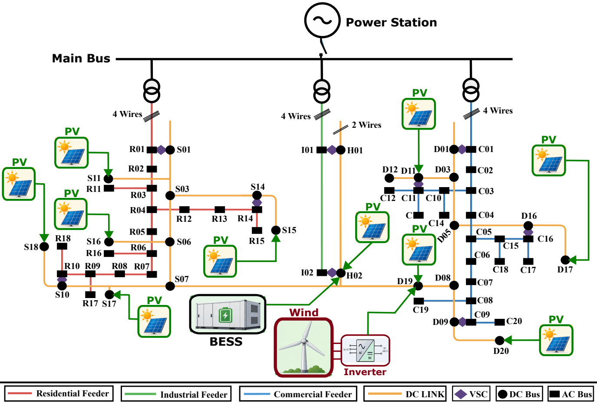

*Hybrid AC/DC CIGRE LV Topology-3 with the DC-side BESS, PV and wind turbine introduced in this study
(author-created schematic; figure of the paper).* The network and its validated PyDAE implementation
are those of the Topology-3 benchmark (Kamoona and Mauricio, *Eng* 7(4):147, 2026,
[doi:10.3390/eng7040147](https://doi.org/10.3390/eng7040147);
[repository](https://github.com/MustafaKamoona/New_Topologies_CIGRE)); they are used without modification,
and the BESS, PV and wind are added as constant-power injections at existing DC buses.

| Element | Configuration |
|---|---|
| AC network | Residential, industrial and commercial feeders; 40 AC buses; 400 V (231 V phase-to-neutral); 20/0.4 kV transformers of 500 / 150 / 300 kVA ($`R_{cc}=1\%`$, $`X_{cc}=4\%`$) |
| DC network | Meshed 800-V DC grid, 26 DC buses; DC lines 0.162 Ω/km, 300 A |
| Converters | Nine VSCs: eight P-Q converters with decentralized P-V droop ($`K_{\mathrm{droop}}=10^6`$) and the DC-voltage-forming converter I01-H01 ($`V_{dc}`$-Q); ratings 150 / 50 / 20 kVA, I01-H01 150 kVA |
| BESS | DC hub bus H02; 150 kW / 300 kWh; $`\eta_{\mathrm{ch}}=\eta_{\mathrm{dis}}=0.95`$; SOC 0.10-0.90; initial SOC 0.50 and SOH 0.90; end-of-life SOH 0.80 |
| PV | 450 kWp on 10 DC buses in proportion to their Case-3 DC load ratings: S11 16.50, S15 57.21, S16 60.51, S17 38.50, S18 51.70, H02 98.43, D12 41.69, D17 52.11, D19 16.68, D20 16.68 kWp; Haurwitz clear-sky irradiance, Seville, 15 April, performance ratio 0.85 |
| Wind | One 60-kW turbine at D19; diurnal wind speed (mean 7 m/s, amplitude 1.5 m/s, maximum at 15 h); cubic power curve (cut-in / rated / cut-out 3 / 12 / 25 m/s) |
| Demand | Load case of the benchmark with high DC penetration (Load-2 in the Topology-3 paper), 24 h at 15-min resolution |
| Operating limits | AC voltage 0.95-1.05 pu of 231 V; DC voltage 0.95-1.05 pu of 800 V (760-840 V); converter apparent power |
| Feeder-head current limits | 724.6 / 231.9 / 434.8 A (R01/I01/C01); Industrial (I01): 160-kVA current basis |
| Tariff | Time of use: 0.09 (0-8 h) / 0.14 / 0.22 EUR/kWh (10-14 h and 18-22 h); curtailment penalty 0.05 EUR/kWh; $`\lambda_{\mathrm{deg}}`$ = 450 kEUR per unit degradation |
| DFM design | $`H_f`$ = 60 min; $`\varepsilon`$ = 0.05; allowance of 1 reference cycle per day at 80 % depth |
| Uncertainty | AR(1), $`\phi=0.8`$; PV 10 %, wind 15 % + 3 % of rating, AC and DC demand 5 %; reserve from 20,000 trajectories; 100 Monte Carlo realizations |

## Evaluated strategies

| Strategy | BESS | Limits used by the EMS | Degradation | Network awareness | Uncertainty reserve |
|---|---|---|---|---|---|
| **B0** | No | — | — | — | — |
| **B1** conventional | Yes | Rated power, SOC window, nameplate energy | No | No | No |
| **B2** degradation-aware | Yes | Rated power, SOC window, health-dependent energy | Cost in the objective | No | No |
| **DFM** proposed | Yes | Safe flexibility envelope | Cost in the objective and explicit limit | Yes | Yes |

B2 and DFM share the objective and the optimizer, so their differences arise only from the flexibility
and network information supplied to the EMS. Ablation: **M0** = DFM; **M1** without the
health/degradation limitation; **M2** without the uncertainty reserve; **M3** without the network
envelope and the network-required curtailment.

## Figures of the paper

The nine figures of the paper are listed in their order of appearance. The two schematics are
author-created artwork; the other seven are generated from the released data by
`code/generate_figures.py`.

**Nominal operating conditions** (`Fig_operating_profiles`).
(a) AC, DC and total demand; (b) available PV and wind generation and the curtailment that the network
imposes without storage (B0); (c) time-of-use price. These profiles are common to all strategies. Without
storage, 92.3 kWh of DC-side renewable energy must be curtailed around midday, when the
DC-voltage-forming converter I01-H01 reaches its rating — the congestion that the network envelope of
DFM has to recognize.

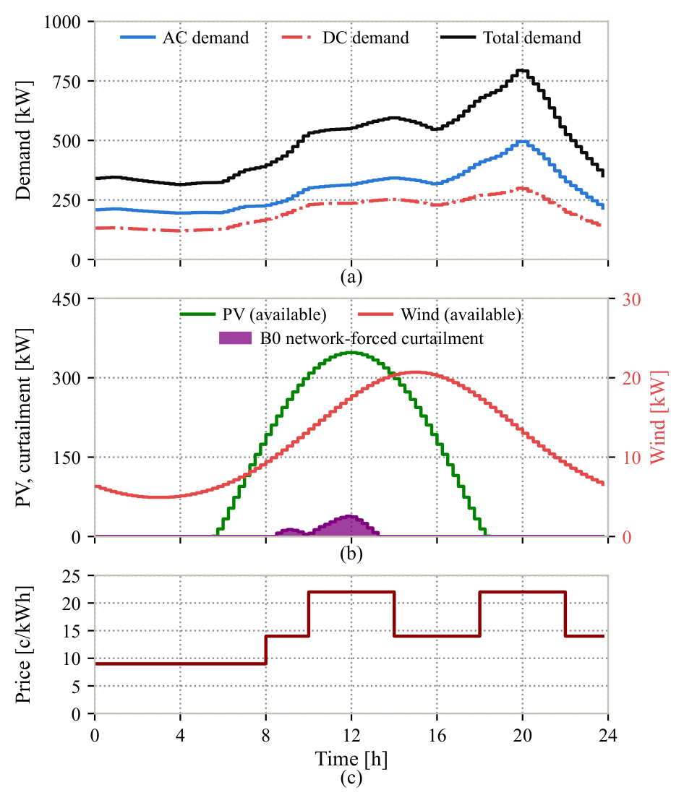

**Evolution of the DFM flexibility envelope** (`Fig_flexibility_evolution`).
Left: nominal day; right: one uncertain realization (Monte Carlo trial 0). Rows: SOC; remaining daily
degradation allowance; rated box, physical envelope (energy ∩ degradation ∩ network) and safe envelope
(after the reserve), with the scheduled and executed BESS power; active limiter. On the nominal day the
safe discharge capability averages 39.9 kW (26.6 % of the rating) and the safe charge
capability 83.9 kW, against physical capabilities of 55.4 and 113.3 kW; the difference
is the reserved headroom. The limiter switches from energy to network (midday converter congestion,
evening feeder-head currents); under uncertainty the real-time compensation consumes the daily allowance,
and the degradation limit becomes active (31 % / 21 % of the discharge/charge
intervals of that day) — use is then excluded rather than merely penalized.

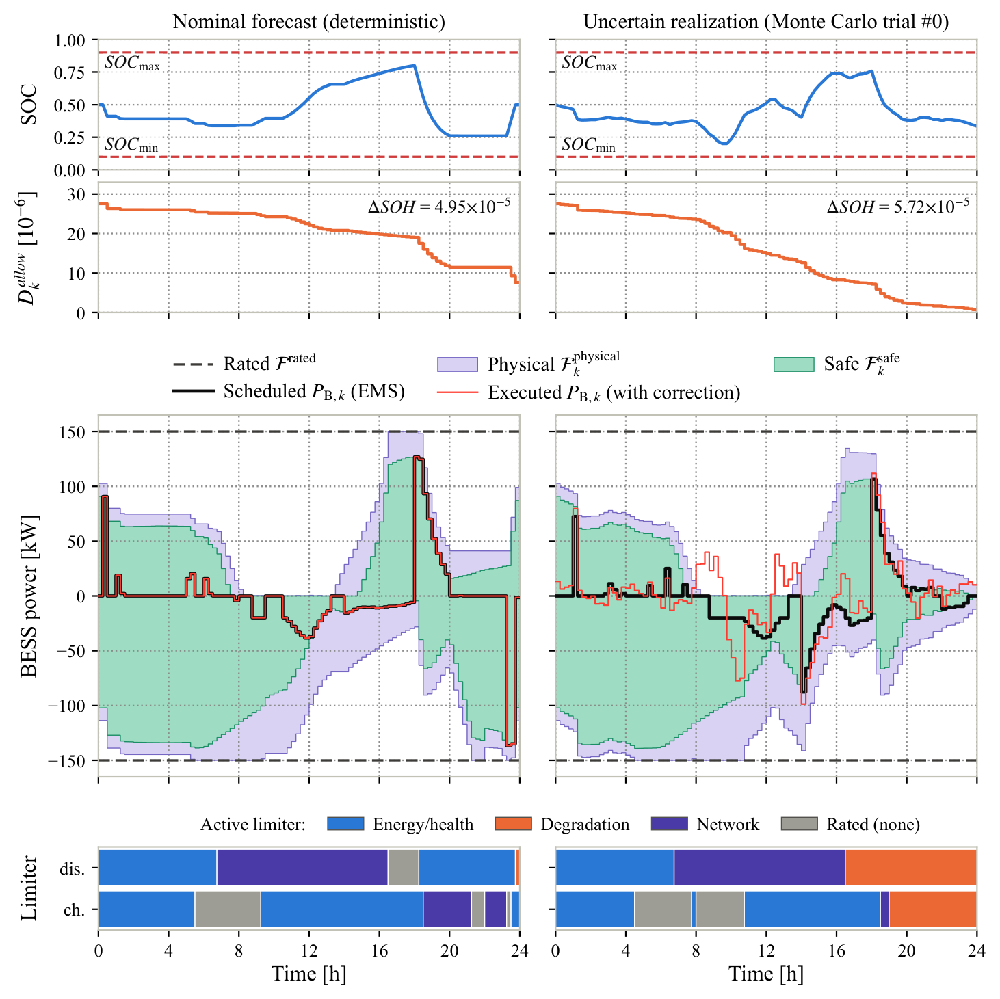

**Energy-management performance on the nominal day** (`Fig_energy_performance`).
BESS power, SOC, change of the grid exchange with respect to B0, and renewable curtailment. B1 and B2
discharge in the 10-14 h peak-price window, i.e. into the midday network congestion, which forces
additional PV curtailment (327.2 and 257.9 kWh). DFM charges at midday at the rate of the
network-required curtailment and shifts this energy to the evening peak, reducing curtailment to
9.7 kWh.

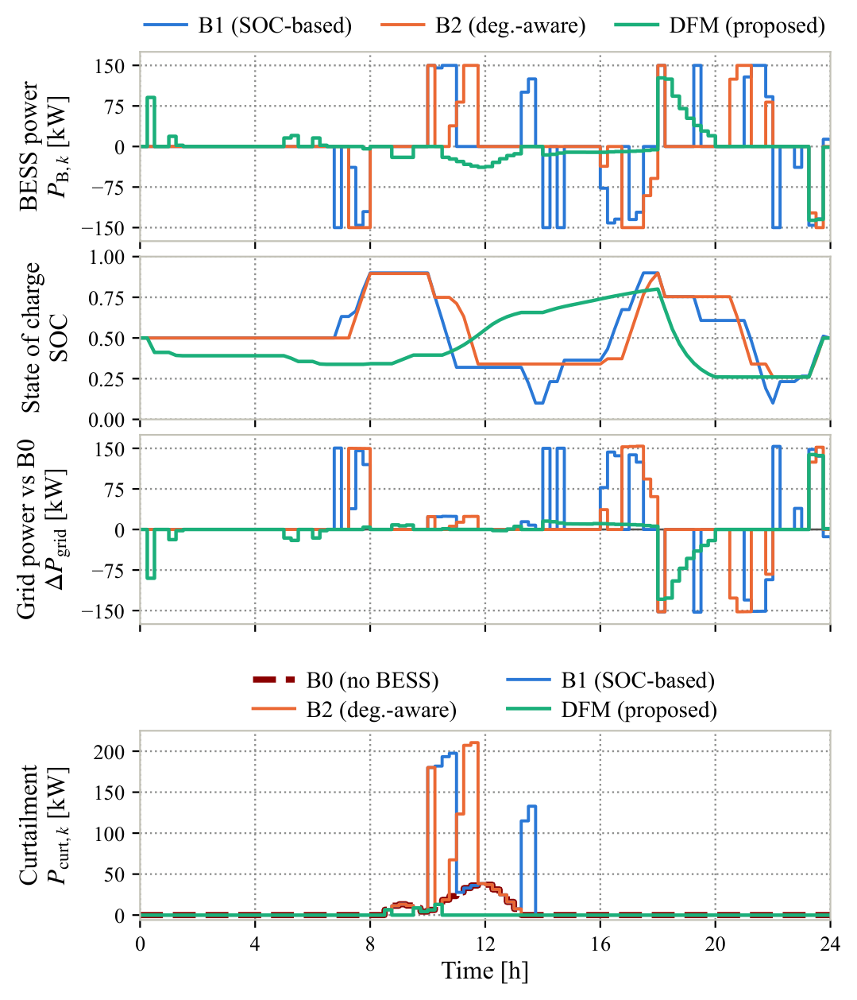

**Network-security indicators on the nominal day** (`Fig_network_security`).
Minimum and maximum AC phase-to-neutral voltage, maximum DC voltage, maximum feeder-head loading (largest
of the three feeder-head currents over its limit) and maximum converter utilization, with the operating
limits (dashed). On the nominal day B0, B2 and DFM have no violation; B1 overloads the I01-H01 converter
when it charges at full rating at 22 h (annotated). The tightest feeder-head margin occurs for B2 at the
evening peak (annotated). Voltage margins are small for all strategies.

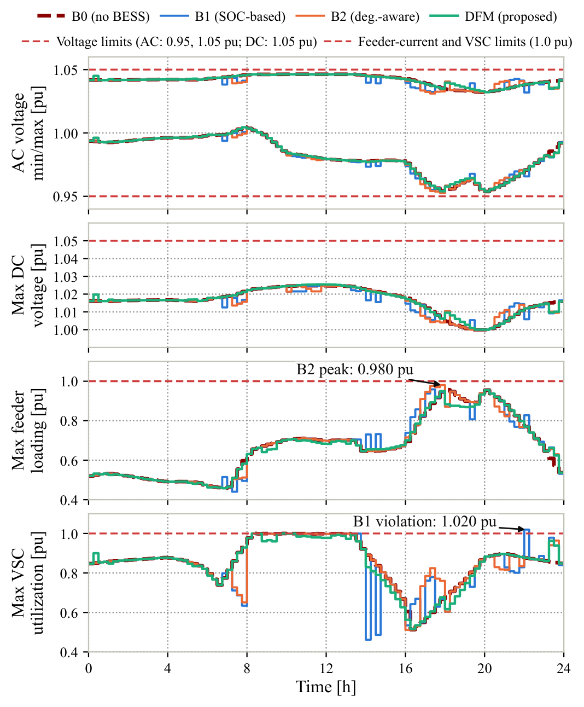

**Monte Carlo robustness** (`Fig_monte_carlo`).
Distributions over 100 paired realizations of energy cost, battery health consumption (rainflow), renewable
curtailment and uncovered forecast-error imbalance; all samples are shown, with outliers in the color of
their strategy. DFM has the lowest cost in 99 % of the realizations against B0 and in all
realizations against B1 and B2, and the lowest health consumption in every realization against B1 and B2.

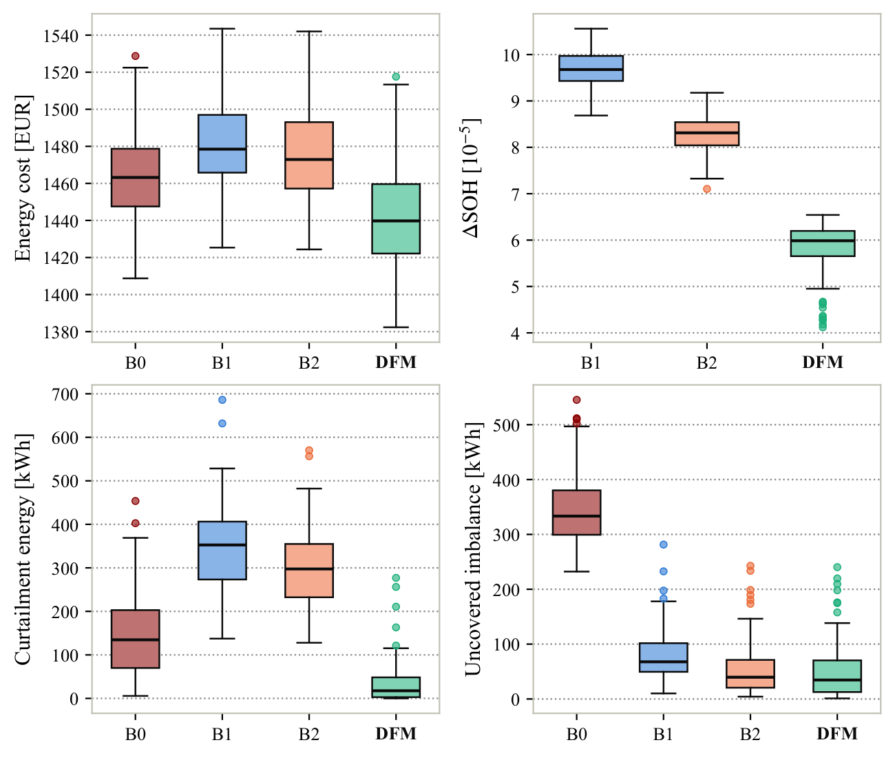

**Net forecast-error distribution and directional reserves** (`Fig_uncertainty_reserve`).
Percentile bands (P1-P99, P5-P95, P25-P75) of the DC-subsystem net forecast error from the 20,000 reserve
trajectories, and the directional reserves at $`\varepsilon = 0.05`$ (which are, by definition, the P95 and
P5 boundaries). The P99-P1 spread ranges from 30.1 kW (3.75 h) to 173.8 kW
(11.75 h), driven by the PV forecast error at midday; the reserves reach 61.68 kW
(discharge) and 60.66 kW (charge). These reserves determine how much of the physical envelope
can be committed.

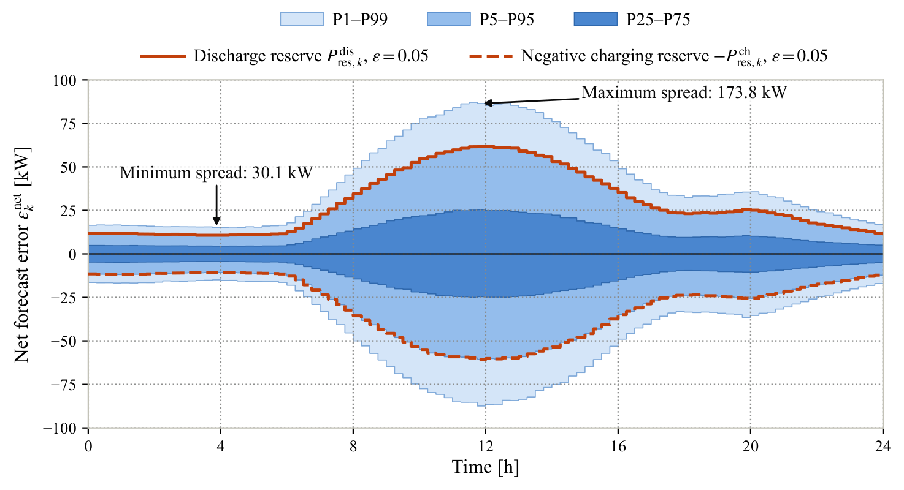

**Ablation and sensitivity** (`Fig_ablation_sensitivity`).
Left: change of the Monte Carlo means when one component is removed (symmetric-logarithmic axis, labels
give the largest changes). Other panels: change with respect to the nominal design when the support
horizon $`H_f`$, risk tolerance $`\varepsilon`$, initial health $`SOH_0`$ or degradation allowance $`N_{\mathrm{ref}}`$
is varied (dashed line: nominal value).

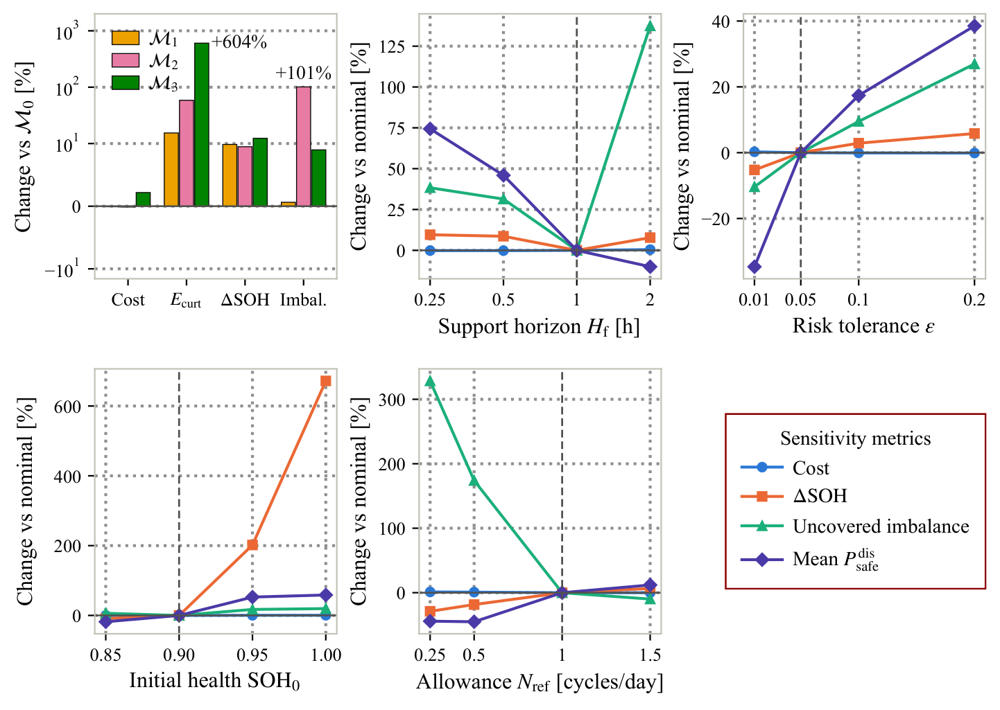

## Supporting figures

The following figures were produced in the research workflow but are **not included in the paper**.
They document components of the framework and are generated from the released data by the same script.

**Network-deliverable BESS limits** (`Fig_flexibility_limits`, supporting figure).
Network-deliverable discharge and charge power for the forecast conditions, the curtailment required
without storage, the rated power, and the intervals in which the converter rating (discharge) or the
feeder-head current (charge) is the binding network constraint. During the network-curtailment period
(8.5-13.25 h) the deliverable discharge power does not exceed 0.6 kW,
because the PV surplus already loads I01-H01 to its rating; at the evening peak the feeder-head current
limits charging to as little as 65.6 kW. This is the network component $`\mathcal{F}^{\mathrm{net}}_k`$ of
the envelope.

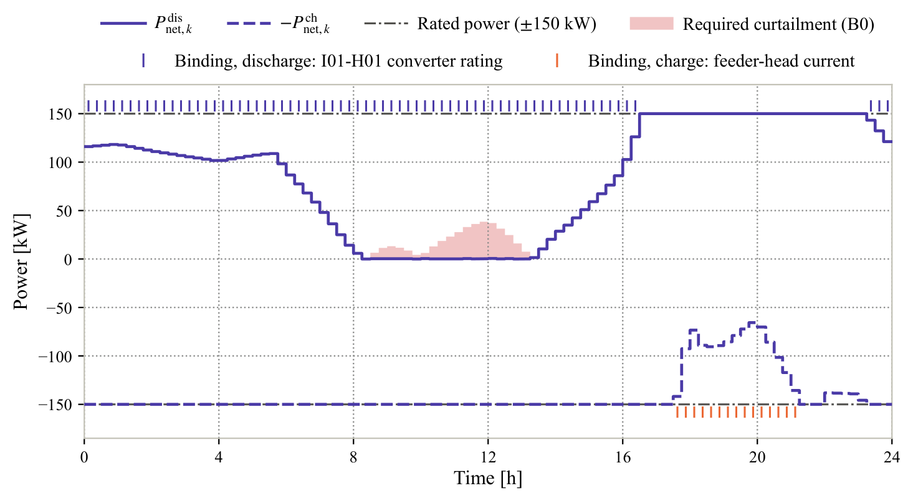

**Battery degradation model** (`Fig_degradation_model`, supporting figure).
(a) Cycle-depth stress $`\Phi(\delta)`$ and full-cycle stress $`G(\delta)`$; (b) marginal stress of the ten
equal cycle-depth segments, exact and as represented by the convex hull in the EMS; (c) SOH as a function
of the linearized degradation $`F`$, showing the fast initial SEI-film fade, the initial health values of
the sensitivity analysis and the end-of-life threshold. The curves are evaluated from the closed-form
model with its published parameters and checked against the released degradation parameters. This figure
keeps the typography of the study's working figures.

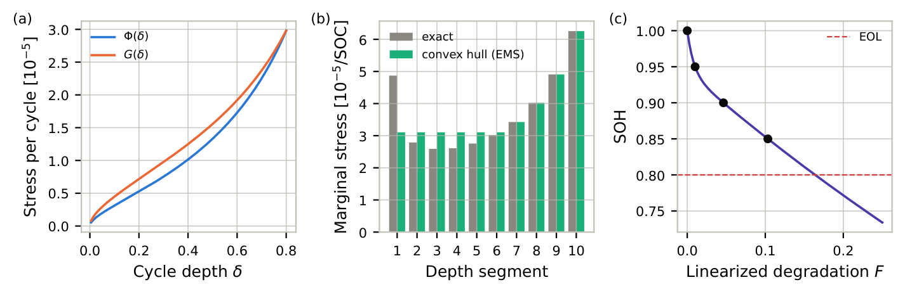

## Main results

All values are read from the released files in `data/`. Nominal-day and Monte Carlo results are reported
separately.

### Nominal day

| Metric | B0 | B1 | B2 | DFM |
|---|---:|---:|---:|---:|
| Grid energy [kWh] | 9146 | 9427 | 9346 | 9081 |
| Energy cost [EUR] | 1457.5 | 1476.9 | 1468.5 | 1439.1 |
| Renewable curtailment [kWh] | 92.3 | 327.2 | 257.9 | 9.7 |
| Renewable utilization [%] | 97.0 | 89.2 | 91.5 | 99.7 |
| Network losses [kWh] | 206.2 | 208.0 | 208.2 | 204.3 |
| ΔSOH [10⁻⁵] | — | 8.61 | 6.92 | 4.95 |
| Equivalent full cycles [–] | — | 1.45 | 1.08 | 0.63 |
| Intervals with a network violation | 0 | 1 | 0 | 0 |

Grid energy and cost are corrected by the energy needed to restore the initial SOC (valued at the valley
price). $`\Delta SOH`$ is evaluated by rainflow counting of the realized SOC trajectory and is dominated by
calendar aging at this time scale; it is not reported for B0, which has no battery.

### Monte Carlo analysis (100 paired realizations)

| Metric | Statistic | B0 | B1 | B2 | DFM |
|---|---|---:|---:|---:|---:|
| Grid energy [kWh] | Mean | 9186 | 9447 | 9389 | 9103 |
|  | P95 | 9451 | 9688 | 9658 | 9418 |
| Energy cost [EUR] | Mean | 1465.0 | 1480.4 | 1475.6 | 1441.7 |
|  | P95 | 1508.0 | 1519.9 | 1521.7 | 1495.9 |
| Renewable curtailment [kWh] | Mean | 143.0 | 349.2 | 301.0 | 36.3 |
|  | P95 | 298.3 | 497.5 | 422.8 | 115.5 |
| ΔSOH [10⁻⁵] | Mean | — | 9.70 | 8.28 | 5.82 |
|  | P95 | — | 10.39 | 8.77 | 6.41 |
| Uncovered imbalance [kWh] | Mean | 346.0 | 79.1 | 56.2 | 51.6 |
|  | P95 | 478.0 | 169.7 | 173.9 | 174.9 |
| Max. normalized exceedance [%] | P95 | 2.49 | 7.03 | 13.06 | 2.53 |
| Realizations with a violation [%] | — | 37 | 93 | 70 | 33 |
| Mean MILP solution time [ms] | Mean | — | 9 | 34 | 285 |

Paired comparison of DFM with each benchmark (mean relative change; Wilcoxon signed-rank test):

| DFM vs | Energy cost | Curtailment | ΔSOH | Uncovered imbalance |
|---|---:|---:|---:|---:|
| B1 | -2.6 % (better in 100 %; p < 0.001) | -89.6 % (better in 100 %; p < 0.001) | -40.0 % (better in 100 %; p < 0.001) | -34.7 % (better in 76 %; p < 0.001) |
| B2 | -2.3 % (better in 100 %; p < 0.001) | -87.9 % (better in 100 %; p < 0.001) | -29.7 % (better in 100 %; p < 0.001) | -8.2 % (better in 62 %; p = 0.07) |
| B0 | -1.6 % (better in 99 %; p < 0.001) | -74.6 % (better in 100 %; p < 0.001) | — | -85.1 % (better in 100 %; p < 0.001) |

The reduction of the uncovered imbalance with respect to B2 is not statistically significant. Under
uncertainty DFM ends the day with a mean SOC of 0.375 instead of 0.50, because the real-time
compensation consumes the daily allowance; this deficit is included in the corrected grid energy and cost.

### Ablation (Monte Carlo means)

| Configuration | Grid energy [kWh] | Cost [EUR] | Curtailment [kWh] | ΔSOH [10⁻⁵] | Imbalance [kWh] | Realizations with violation [%] | Solution time mean / P95 [ms] |
|---|---:|---:|---:|---:|---:|---:|---:|
| M0 (DFM) | 9103 | 1441.7 | 36.3 | 5.82 | 51.6 | 33 | 285 / 1034 |
| M1 (no health/degradation limit) | 9112 | 1440.4 (-0.1 %) | 41.9 (+15.4 %) | 6.40 (+9.9 %) | 51.9 (+0.6 %) | 29 | 207 / 856 |
| M2 (no reserve) | 9124 | 1439.8 (-0.1 %) | 57.5 (+58.6 %) | 6.38 (+9.5 %) | 103.8 (+101.1 %) | 32 | 70 / 185 |
| M3 (no network envelope) | 9326 | 1473.1 (+2.2 %) | 255.4 (+603.7 %) | 6.55 (+12.4 %) | 56.2 (+9.0 %) | 37 | 505 / 2644 |

### Sensitivity (Monte Carlo means of DFM)

| Parameter | Value | Mean safe discharge [kW] | Cost [EUR] | Curtailment [kWh] | ΔSOH [10⁻⁵] | Imbalance [kWh] | Degradation-limited discharge intervals [%] |
|---|---|---:|---:|---:|---:|---:|---:|
| Support horizon H_f | 15 min | 60.7 | 1439.9 | 56.9 | 6.38 | 71.4 | 9 |
|  | 30 min | 50.8 | 1439.5 | 51.5 | 6.33 | 67.8 | 10 |
|  | 60 min (nominal) | 34.8 | 1441.7 | 36.3 | 5.82 | 51.6 | 18 |
|  | 120 min | 31.3 | 1448.3 | 111.9 | 6.28 | 122.5 | 2 |
| Risk tolerance ε | 0.01 | 22.7 | 1445.5 | 31.9 | 5.52 | 46.3 | 25 |
|  | 0.05 (nominal) | 34.8 | 1441.7 | 36.3 | 5.82 | 51.6 | 18 |
|  | 0.1 | 40.8 | 1440.9 | 39.9 | 5.99 | 56.5 | 14 |
|  | 0.2 | 48.2 | 1440.2 | 45.1 | 6.16 | 65.5 | 10 |
| Initial SOH | 1.00 | 55.2 | 1449.0 | 58.9 | 44.96 | 61.8 | 1 |
|  | 0.95 | 53.1 | 1447.7 | 51.5 | 17.58 | 60.5 | 2 |
|  | 0.90 (nominal) | 34.8 | 1441.7 | 36.3 | 5.82 | 51.6 | 18 |
|  | 0.85 | 28.5 | 1443.8 | 36.5 | 5.30 | 54.8 | 23 |
| Allowance N_ref [cycles/day] | 0.25 | 19.4 | 1459.0 | 92.8 | 4.14 | 221.1 | 72 |
|  | 0.5 | 19.1 | 1454.7 | 48.2 | 4.76 | 141.4 | 40 |
|  | 1 (nominal) | 34.8 | 1441.7 | 36.3 | 5.82 | 51.6 | 18 |
|  | 1.5 | 39.0 | 1441.6 | 36.3 | 6.21 | 46.5 | 0 |

## Scope and limitations

- **Network security is enforced for the forecast conditions, not guaranteed under uncertainty.** The
  network envelope is evaluated for the forecast; violations still occur in 33 % of the DFM
  realizations (37 % without storage), and 32 of the 33 affected DFM
  realizations also show a violation without storage. The released data record which realizations and how
  many intervals are affected, but not which constraint or interval.
- The evaluation uses one representative day, a numerical benchmark and an established aging model;
  $`\Delta SOH`$ values are single-day values and should be read as relative differences.

## Repository structure

```text
.
├── README.md                 this document
├── LICENSE                   license
├── CITATION.cff              citation metadata
├── requirements.txt          dependencies for figure reproduction
├── requirements-full.txt     additional dependencies for re-running the full study
├── code/
│   ├── generate_figures.py   command-line figure generation from the released data
│   ├── dfm_figures/          one module per figure (presentation settings + plotting)
│   ├── dfm_acdc/             implementation of the DFM framework and the closed-loop simulation
│   ├── experiments/          notebooks 01-11 of the numerical study (outputs cleared)
│   └── README.md
├── data/                     released results (CSV), documented in data/README.md
├── figures/                  final figure files (PDF): paper and supporting figures
├── README_Figures/           PNG versions of the figures for this document
├── docs/reproducibility.md   reproducibility levels, environment and implementation notes
└── external/README.md        how to obtain the external Topology-3 network model
```

## Installation and use

```bash
# from the root folder of a local copy of this repository
python -m venv .venv
# Windows: .venv\Scripts\activate    Linux/macOS: source .venv/bin/activate
pip install -r requirements.txt

python code/generate_figures.py --list              # available figures
python code/generate_figures.py                     # all data-driven figures (PDF) -> output/figures/
python code/generate_figures.py Fig_monte_carlo     # one figure
python code/generate_figures.py --png --dpi 200     # PDF and PNG
```

The script reads only the released CSV files, writes only to `output/`, and never modifies `figures/`.
With the tested environment the regenerated PDFs are identical, at pixel level, to the files in
`figures/`. The figures use Times New Roman and STIX; without Times New Roman, Matplotlib uses another
serif font. Presentation settings are grouped at the top of each module in `code/dfm_figures/`.

`Fig_uncertainty_reserve` recomputes its percentile bands from the 20,000 forecast-error trajectories of
the study, drawn deterministically (fixed seed) from the released nominal profiles; it first verifies
that these samples reproduce every released reserve value. `Fig_topology3_dfm` and `Fig_dfm_framework`
are author-created artwork and are not generated by code.

The released data can also be analyzed directly, for example:

```python
import pandas as pd
mc = pd.read_csv("data/monte_carlo/results_mc_trials.csv")
print(mc.groupby("strategy")[["cost_corr_EUR", "E_curt_kWh", "dSOH_rainflow", "n_viol_intervals"]].mean())
```

## Reproducibility

| Level | Scope | Requirements |
|---|---|---|
| 1 | Regenerate all data-driven figures | This repository, `requirements.txt` |
| 2 | Inspect and re-analyze the results (per-interval logs, per-trial results, summaries, validation checks) | This repository |
| 3 | Re-run the network simulations | External Topology-3 model ([`external/README.md`](external/README.md)), PyDAE 1.5.1, `requirements-full.txt` |
| 4 | Re-run the EMS, Monte Carlo, ablation and sensitivity experiments (`code/experiments/`) | Level 3; about 16 h of single-process computation for the 2,117 closed-loop runs, executed in parallel |

The Topology-3 model is not duplicated here; it is available with its builder, load data and regression
outputs from the Topology-3 repository. The compiled network solver is platform-specific; levels 3-4
were executed on Windows x64 with Python 3.10. See [`docs/reproducibility.md`](docs/reproducibility.md).

## Data availability

`data/` contains every result file used for the figures, tables and quoted numbers: per-interval logs of
the nominal day (B0, B1, B2, DFM) and of one uncertain realization (DFM); the nominal profiles,
network-deliverable limits and uncertainty reserves; per-trial and summary results of the Monte Carlo,
ablation and sensitivity analyses; and verification results. Direct simulation outputs and processed
results are distinguished in [`data/README.md`](data/README.md). The forecast-error ensembles and the
per-interval logs of the Monte Carlo runs are not stored; they are regenerated deterministically
(fixed seeds) at levels 3-4.

## Citation

Please cite this research software and data and, for the network model, the published Topology-3
benchmark:

```bibtex
@misc{Kamoona_DFM_code,
  author = {Kamoona, Mustafa A. and Mauricio, Juan Manuel},
  title  = {Dynamic Flexibility Management of Battery Energy Storage in Hybrid {AC/DC} Distribution
            Networks: A Health-Aware Flexibility Envelope Approach -- research code, numerical
            datasets and figures},
  note   = {Software and data, version 1.0.0}
}

@article{Kamoona2026Eng,
  author  = {Kamoona, Mustafa A. and Mauricio, Juan Manuel},
  title   = {Hybrid {AC/DC} Topologies for the {CIGRE} Low-Voltage Benchmark Performance Evaluation},
  journal = {Eng},
  volume  = {7},
  number  = {4},
  pages   = {147},
  year    = {2026},
  doi     = {10.3390/eng7040147}
}
```

Machine-readable metadata: [`CITATION.cff`](CITATION.cff).

**Topology-3 implementation.** Repository: https://github.com/MustafaKamoona/New_Topologies_CIGRE.
Archived version on Zenodo: record [18325627](https://zenodo.org/records/18325627). Zenodo assigns a
*version DOI* to each archived release and a *concept DOI* that always resolves to the latest version;
cite the version DOI to refer to the exact code used.

## License, acknowledgments and funding

The code is distributed under the MIT License ([`LICENSE`](LICENSE)). Third-party components used but
not redistributed: PyDAE (MIT) and the Topology-3 network model (see its repository); NumPy, SciPy,
pandas and Matplotlib. Battery aging parameters: B. Xu et al., *IEEE Transactions on Smart Grid*
9(2):1131-1140, 2018, with the piecewise-linear cycle-depth representation of B. Xu et al., *IEEE
Transactions on Power Systems* 33(2):2248-2259, 2018.

This work was supported by the Ministerio de Ciencia e Innovación (MCIN), Agencia Estatal de
Investigación (AEI), 10.13039/501100011033, through the European Regional Development Fund (ERDF), "A way
of making Europe," under Grant PID2021-124571OB-I00; by CDTI under Project Ad-Grhid MIG-20221009,
127835OB-I00; and by the European Commission through the projects COCOON (COoperative Cyber prOtectiON for
modern power grids) under Grant 101120221 and SUNRISE under Grant 101079200.
"# DFM_Hybrid_ACDC_BESS" 
